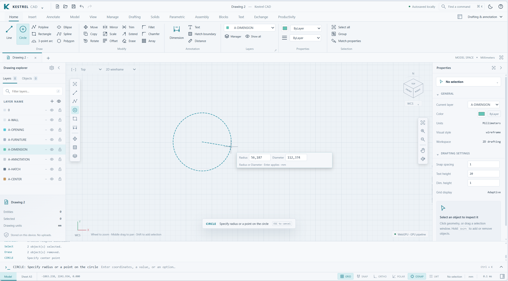

# Kestrel CAD



A fork of [wieslawsoltes/KestrelCAD](https://github.com/wieslawsoltes/KestrelCAD).

Local-first 2D drafting and 3D modeling in plain HTML, CSS and JavaScript. A custom WebGPU renderer with an automatic Canvas fallback, CAD ribbon, command line, layers, selection, grips and atomic undo/redo. No JavaScript framework, no CDN, no account, no remote drawing service.

Branch builds are not the live site: changes merge into `main` before GitHub Pages publishes them. This is an original Kestrel application, not an Autodesk product or a feature-complete AutoCAD replacement — the honest boundaries are stated in each section below.

## Quick start

No runtime dependencies. The application needs only a browser; the server is pure Python standard library.

**Windows (new machine):**

```text
1. Install Python 3.10+ with "Add to PATH" ticked.
2. Run install.bat          (one-time: creates .venv, installs dev/test
                             deps, optionally downloads the LibreDWG
                             DWG codec and adds it to your user PATH)
3. Run start.bat            (serves the app and opens http://localhost:8000)
```

**macOS / Linux / any platform:**

```sh
python3 tools/serve.py --open   # or: ./start.sh
```

Open `http://localhost:8000/`. The server binds to localhost only.

`install.bat` and the venv are tooling-only (tests, build, DWG codec). The application itself runs without any pip/npm package; `python3 tools/serve.py` alone is enough. The optional local B-rep kernel is installed separately, with `requirements-kernel.txt` — see [Native B-rep modeling](#native-b-rep-modeling).

The standalone `Kestrel-CAD.html` is built with `python3 tools/build.py` and can also be served by a static HTTPS host. WebGPU is used only if its adapter and pipelines initialize; otherwise Canvas rendering takes over, and the status bar shows the active renderer.

## Everyday drafting (2D)

- **Geometry:** lines, polylines, rectangles, polygons, circles, arcs, ellipses, control-point splines, points, text, aligned dimensions, hatches.
- **Modify:** move/copy/rotate/scale/mirror/offset, trim/extend, fillet/chamfer, rectangular and polar arrays, join/explode, groups, and property editing — including assigning a layer from the ribbon layer select when a selection is active (like AutoCAD's layer control).
- **Command line:** `LINE 0,0 100,0 @0,80 ENTER`, `RECTANGLE 150,0 250,80`, `CIRCLE 200,40 20`, `FIT`. Ctrl+K searches commands; Ctrl+N/O/S create/open/save; Ctrl+Z/Y undo/redo; Enter finishes a path, Escape cancels.
- **View and snapping:** wheel zoom, middle-drag pan, Shift+middle-drag orbit; left-to-right selection contains, right-to-left crosses; F3/F7/F8/F9/F10 toggle object snap, grid, ortho, grid snap and polar tracking.

Example drawings (architectural and mechanical) ship in the app.

## Production drafting v2

The **Drafting** ribbon tab adds shared blocks and attributes, extra dimension modes and styles, associative hatch islands, leaders, editable tables, stretch/break/align, local reference snapshots, UCS, layouts and scaled output. Native project version 2 persists this metadata and still reads version 1 projects.

- `BLOCK` / `BINSERT` / `BEDIT` / `BCLOSE` author, place and edit shared geometry; `ATTEDIT` edits attribute definitions and per-instance values.
- Copy/paste across drawing tabs carries referenced definitions, layers and dimension styles.
- `DIMLINEAR` measures projected X/Y distance and can stay associated with selected line endpoints; `HATCHISLANDS` builds even-odd fills with nested holes and islands.
- `LAYOUT` stores paper dimensions in millimeters and viewport scale denominators; `PLOT` downloads SVG with physical page dimensions or opens a print preview (top-view output, not full paper-space editing; browser print scale must be 100%).

See [command-by-command review](docs/V2-REVIEW.md) for boundaries and known gaps.

## Rich annotations: MTEXT, fields, search

- **MTEXT** creates native rich annotations (formatting fractions, paragraphs, masks, native columns, bidirectional runs) that persist through saves and undo; single-column DXF export stays genuine MTEXT. [MTEXT commands](docs/MTEXT.md).
- **FIELD** binds TEXT/MTEXT, leaders, table cells and INSERT attributes to measurements, drawing/Custom properties, named parameters, aggregates and safe formulas; source edits update labels in the same undo step. Native-body quantity fields cover validated volume/area with unit conversion, and `FIELDTABLE` builds linked schedules. [Field authoring and schema](docs/FIELDS.md).
- **`FIND` / `REPLACE` / Ctrl+F** search visible annotation content, preserve rich MTEXT controls during replacement, protect linked fields and locked objects, and group changes into one undo step. [Scopes and safety](docs/TEXT-SEARCH.md).

## Parametric sketching

The **Parametric** ribbon adds named expressions and maintained planar geometric/dimensional constraints. `PARAMDEMO` creates a fully constrained rectangle; edit `Width` in **Parameters** and `Height = Width * 0.6` follows. `SHOWCONSTRAINTS` toggles constraint bars; `CONSTRAINTS`, `PARAMETERS`, `SOLVE` and `CONSTRAINTMODE` manage the system.

A bounded **planar nonlinear solver**, not a 3D assembly engine: one saved plane per drawing, a fixed set of supported entity types, and stated variable/record limits. Equations persist in `.kcad`; ordinary DXF exchange carries evaluated geometry only. [Details and limits](docs/PARAMETRIC.md).

## Configurable blocks

The **Blocks** ribbon adds typed instance parameters, safe derived expressions, lookup tables, visibility states, flip/move/stretch/rotate/scale and rectangular-array actions. `DYNAMICDEMO` opens two configurable fabrication plates; `BRESET`, `BDEFINE` and `BACTION` author behavior; `BLOOKUPMATCH` matches a lookup row; polar array actions sweep arbitrary 3D axes. `BEDIT`-time polar stretch is covered by [POLAR-STRETCH.md](docs/POLAR-STRETCH.md).

Members render with their own layer/color/line properties plus ByBlock inheritance. DXF exports evaluated static variants, **not** proprietary AutoCAD dynamic-block actions. [Workflows and limits](docs/DYNAMIC-BLOCKS.md), and [polar blocks and lookup matching](docs/POLAR-BLOCKS.md).

## Native B-rep modeling

The **Solids** ribbon adds an optional local **OpenCascade** kernel through CadQuery (`requirements-kernel.txt`, Python 3.11+). It is not ACIS and does not read/write SAT/SAB — for planar SAT/SAB exchange see [ACIS exchange](#planar-acis-exchange).

```sh
python3 -m pip install -r requirements-kernel.txt
python3 tools/serve.py --open
```

Box/cylinder/cone/sphere/torus, extrude (including inner wires), revolve, loft and sweep, boolean union/subtract/intersect, fillet/chamfer, shell, section and affine transforms operate on real B-rep topology, with STEP/IGES/BREP exchange. Invalid results reject before an undoable change is committed; existing meshes are never silently upgraded to exact solids.

`XEDGES`, `SECTIONCURVES` and `INTERFERE`/`CLEARANCE` extend workflows: [native curves](docs/NATIVE-CURVES.md) and [material interference](docs/NATIVE-ANALYSIS.md).

Projects retain native BREP bytes and transformations; the display mesh renders on GitHub Pages without the engine, while native computation and exchange require the local server. `SOLIDINFO` reports native topology and mass properties; `SOLIDDETACH` converts a native object to a plain editable mesh; undo restores it. See [native modeling details](docs/NATIVE-SOLIDS.md).

## Assembly constraints

The **Assembly** ribbon adds world-XYZ geometric and dimensional constraints and rigid poses for meshes, native B-rep bodies and block references. Hinge, slider, coaxial, plane and fastened mates coexist with the planar solver on disjoint geometry; `3DASSEMBLY` opens a parameter-driven lift example, `JOINTLIMITS`/`DRIVEJOINT` add travel limits and drivers with transactional rollback. Failed solves roll back atomically. This is a bounded numerical solver, not a general deformable/contact engine. [Spatial constraints](docs/SPATIAL-CONSTRAINTS.md), [joint limits](docs/JOINT-LIMITS.md).

## File exchange and fidelity

- **Native `.kcad` projects** retain supported editable objects and production metadata (not undo history). The Exchange ribbon (`SOURCEORIGINAL`, `SOURCEINFO`, `DXFSAVE`, `DXFEXPORT`, `DXFBINARY`) opens DXF files with the entire original preserved — including unknown records and LibreDWG-style `999` comments — alongside editable supported geometry. Guarded DXF saves patch supported edits while keeping other records; unsupported changes refuse rather than silently discard content. [Source documents](docs/SOURCE-DOCUMENTS.md).
- **DXF:** reads ASCII and binary DXF; compatibility export writes the supported AC1015/R2000 subset. New table/leader and non-linear dimension modes export as display geometry; UCS, associations and layouts are native-only; unsupported imports are reported.
- **DWG** requires separately installed GNU LibreDWG `dwg2dxf`/`dxf2dwg` and the local server (`install.bat` can set this up). The bridge is not available on GitHub Pages; codecs are never bundled; the supported DXF subset remains the fidelity bottleneck even with a codec.
- **Output:** PNG viewport capture, SVG vector and layout pages, PLOT previews.
- **Fonts:** user-provided SHX/SHP stroke fonts render as real stroke geometry; text referencing fonts missing from the file (including Cyrillic SHX styles) falls back to a clearly reported substitute font instead of dropping content; outline fonts use browser text shaping. Font files are neither bundled nor uploaded, and missing glyphs are reported. [Font workflows](docs/FONTS.md).

Baseline 3D tools produce **polygon meshes** (primitives, extrude/revolve, BSP mesh booleans, sections), not exact analytic models — check exported parts independently before manufacturing.

## Tests and build

```sh
python3 -m pip install -r requirements-dev.txt
python3 -m playwright install chromium
python3 tools/verify.py --previews
```

- Set `CHROMIUM_PATH` when Chromium is not at `/usr/bin/chromium`, and `KESTREL_TEST_URL=http://localhost:8642/` to test a served application instead of the standalone HTML. Fresh results land in `tests/results/`; `build-info.json` is generated during verification.
- Playwright and ezdxf are test-only; CadQuery is an optional local modeling dependency, never downloaded by the browser.
- Plain-Node suites (`tests/*.test.js`, run with `node tests/<name>.test.js`) cover fonts, mtext, constraints, blocks and more; `tests/*.browser.py` drive the real UI through Playwright, and ezdxf audit scripts independently verify DXF exchange. The native browser suite exercises the actual localhost worker.

## Source layout

| Path | Role |
| --- | --- |
| `src/math.js`, `geometry.js`, `model.js`, `csg.js`, `exchange.js`, `renderer.js` | Core geometry, persistence, rendering |
| `src/production.js` (+ `-ui.js`) | Persistent drafting objects (v2) |
| `src/kernel.js`, `native-*.js` (optional) | Local B-rep kernel bridge and ACIS adapters |
| `src/constraints.js`, `spatial-constraints.js`, `dynamic-blocks.js` | Solver and block engines |
| `src/fonts.js`, `mtext.js`, `fields.js`, `source-document.js`, `text-search.js` | Fonts, rich text, fields, source fidelity |
| `src/ui.js`, `app.js` | UI and editing workflows |
| `tools/serve.py` | Local server and optional DWG codec bridge |
| `tools/build.py` | Standalone `Kestrel-CAD.html` build |
| `tests/` | Core, browser (Playwright), node and ezdxf audit suites |

## Documentation index

Core workflows: [V2 review](docs/V2-REVIEW.md) · [Parametric](docs/PARAMETRIC.md) · [Dynamic blocks](docs/DYNAMIC-BLOCKS.md) · [Polar blocks](docs/POLAR-BLOCKS.md) · [Polar stretch](docs/POLAR-STRETCH.md) · [Native solids](docs/NATIVE-SOLIDS.md) · [Native curves](docs/NATIVE-CURVES.md) · [Native analysis](docs/NATIVE-ANALYSIS.md) · [Native editing](docs/NATIVE-EDITING.md) · [Spatial constraints](docs/SPATIAL-CONSTRAINTS.md) · [Joint limits](docs/JOINT-LIMITS.md)

Data and fidelity: [Source documents](docs/SOURCE-DOCUMENTS.md) · [Exchange fidelity](docs/EXCHANGE-FIDELITY.md) · [ACIS exchange](docs/ACIS-EXCHANGE.md) · [MTEXT](docs/MTEXT.md) · [Fields](docs/FIELDS.md) · [Insert fields](docs/INSERT-FIELDS.md) · [Text search](docs/TEXT-SEARCH.md) · [Fonts](docs/FONTS.md) · [Feature matrix](docs/FEATURE-MATRIX.md) · [Productivity](docs/PRODUCTIVITY.md) · [Productivity integration](docs/PRODUCTIVITY-INTEGRATION.md)

## License

The application source is MIT licensed. Optional third-party tools (CadQuery/OpenCascade, GNU LibreDWG) keep their own licenses and are never downloaded or bundled by the application.
